# The Shadowbloom of Eldenwood

**Current version:** Alpha 0.1.0.5
**Status:** Alpha. The whole campaign is in and ready to play from start to finish, but things will change and you may meet a bug or two.

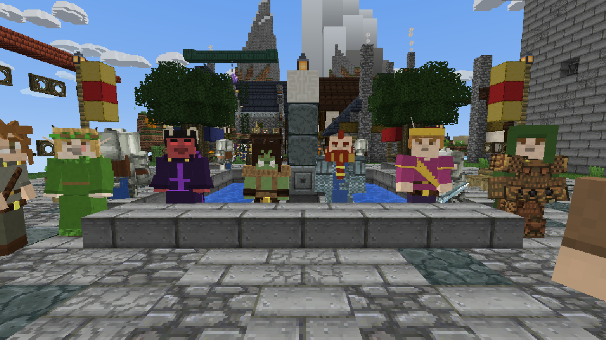

## What is it?

The Shadowbloom of Eldenwood is a fantasy role-playing game in the spirit of a tabletop campaign, set in a world made of blocks.

Something is wrong in the Eldenwood. A strange bloom is creeping through the forest, the towns along the old roads are whispering about lights in the trees and dreams that don't feel like dreams, and a letter is waiting for you that seems to know your name. You wake on the road outside Stonebridge with your pack, your wits and whatever you can do with a sword, a bow or a spell. Where it goes from there is for you to find out.

Make your hero first: pick from nine peoples and twelve classes, give them a past, and dress them how you like, down to the length of their beard. Then step into a world that goes on as far as you care to walk. There are walled towns and quiet villages full of people going about their day, roads and ruins and forests, things that hunt at night, and a story told across three acts, with more than one way it can end.

Play it alone, or bring the whole party: up to four players on one screen, or friends over your home network or the internet.

## Features

- **A real campaign:** a full story from the first letter to the last page, with named people who remember you, conversations where your skills open doors, side quests, letters and dreams, a journal that keeps track of it all, and choices that matter at the end.
- **Make your hero, the Hytale way:** your hero stands on the main menu, and you make them before you make a world. Fifteen species (the nine of the rulebook, and six from Eldenwood's own lands), twelve classes with three subclasses each, and fourteen backgrounds, each class with its starting kit.
- **Heroes and townsfolk in 3D:** sculpted hair, beards (all the way down to a proper wizard's beard), hats, hoods, robes that swing as you walk, cloaks that stream out behind you, horns, tails and pointed ears. Armour grows pauldrons, crests and plates, and you can keep your helmet off your head if you'd rather show your face.
- **Live-action combat:** swing, shoot and cast in real time. Nothing is rolled on screen: a blow that lands, lands, and your skill and their armour decide how hard. Spells, class features (Rage, Second Wind, Lay on Hands, Wild Shape and more) and species gifts like a dragonborn's breath are a key away. Fights get messy, too: limbs can come off.
- **RPG towns:** Stonebridge is a walled city of side streets and squares; the towns and villages around it each have their own character. Step inside and the detail is there: potions and herbs on the apothecary's shelves, books in the library, weapons on racks and armour on stands at the smithy, and townsfolk eating and drinking at the tavern tables.
- **The whole rulebook:** grow from level 1 to 20 with every SRD 5.2 spell, weapon, armour and magic item, feats, multiclassing, spells you choose and prepare yourself, short and long rests, and conditions shown on the HUD.
- **A world to travel:** roads and signposts between every town and place of the story, walled towns whose gates shut at dusk, things that happen on the road (and signs of them before they do), traps and locked chests in the dungeons, horses at the stables, a smith who'll temper and silver your weapon, sellswords at the inn and a house of your own.
- **Controller or keyboard and mouse:** every menu, the hero maker, conversations, the journal, letters, shops and the inventory work with either.
- **Play together:** split screen for **2 to 4 players** (keyboard and mouse or controllers), a world opened to your home network, online play, or a dedicated server. Everyone shares the same story.
- **Made for GeruDoku:** one click in Settings fetches the classic **[GeruDoku](https://github.com/sybenx/GeruDoku)** resource pack from its own release page, and it covers the 3D armour and clothes too.
- **A desktop app for Linux and Windows** that keeps itself up to date.

## Screenshots

*In-game pictures are shown with the [GeruDoku](#recommended-resource-pack-gerudoku) resource pack.*

| | |
|:-:|:-:|
| 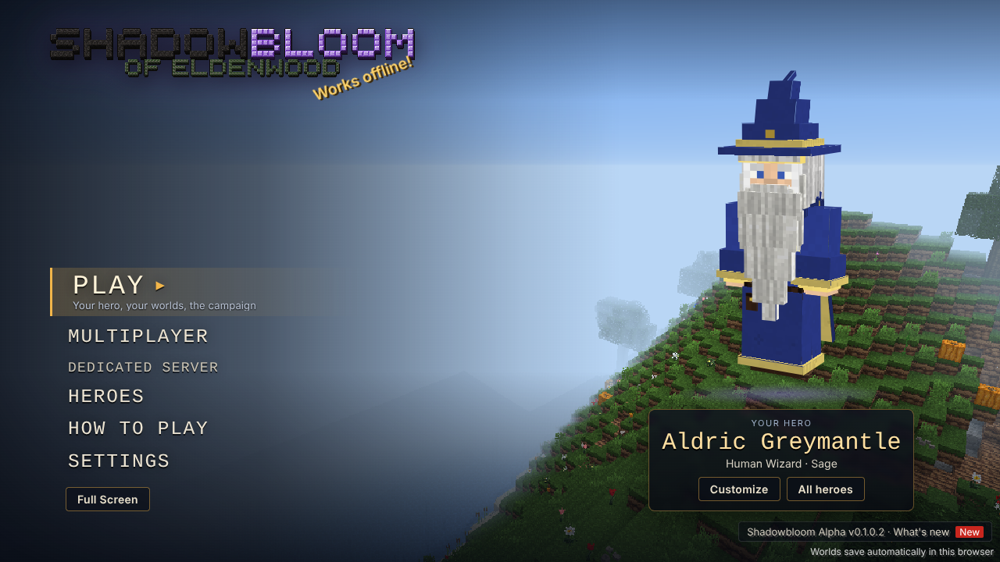 **The main menu**, with your hero | 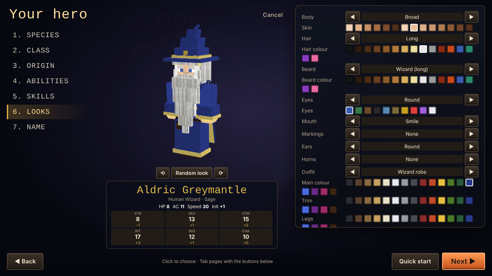 **The hero maker** |
| 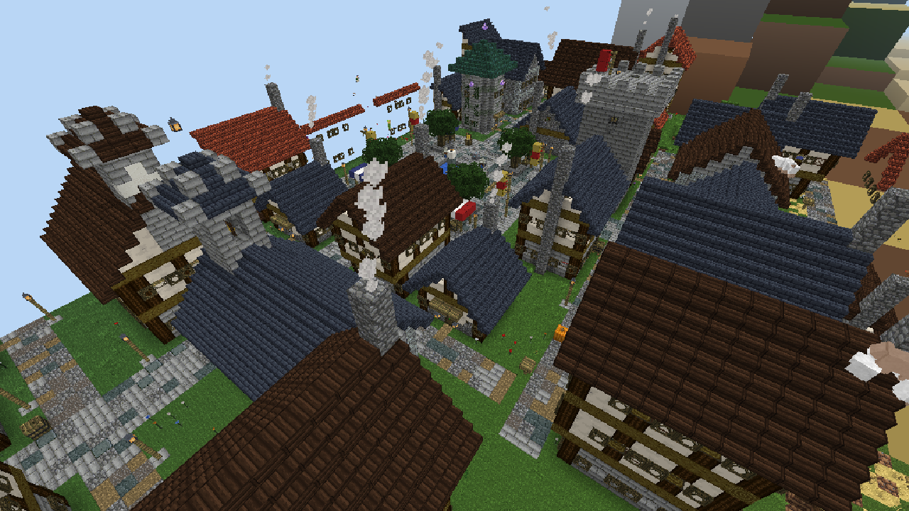 **Stonebridge**, a walled city | 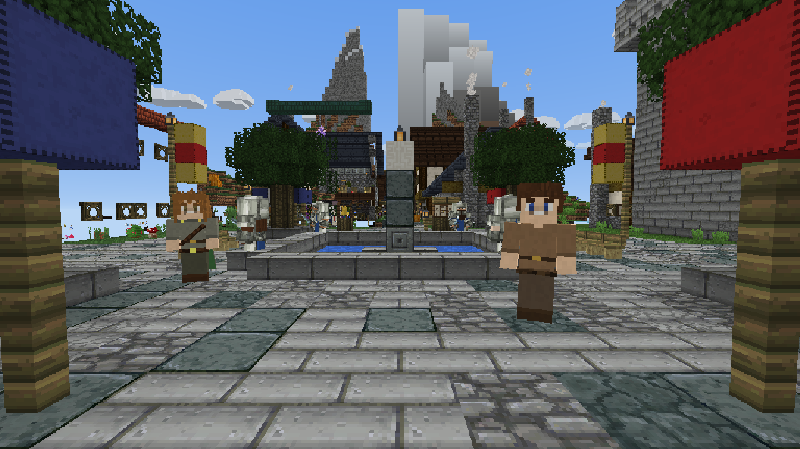 **The square**, busy by day |
| 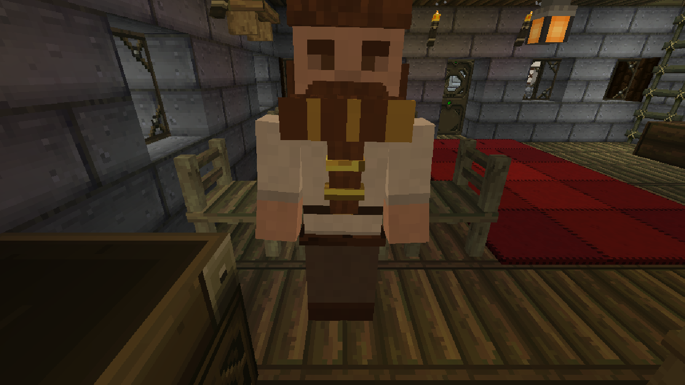 **The inn** and its keeper (everyone wears 3D hair, beards and clothes) | 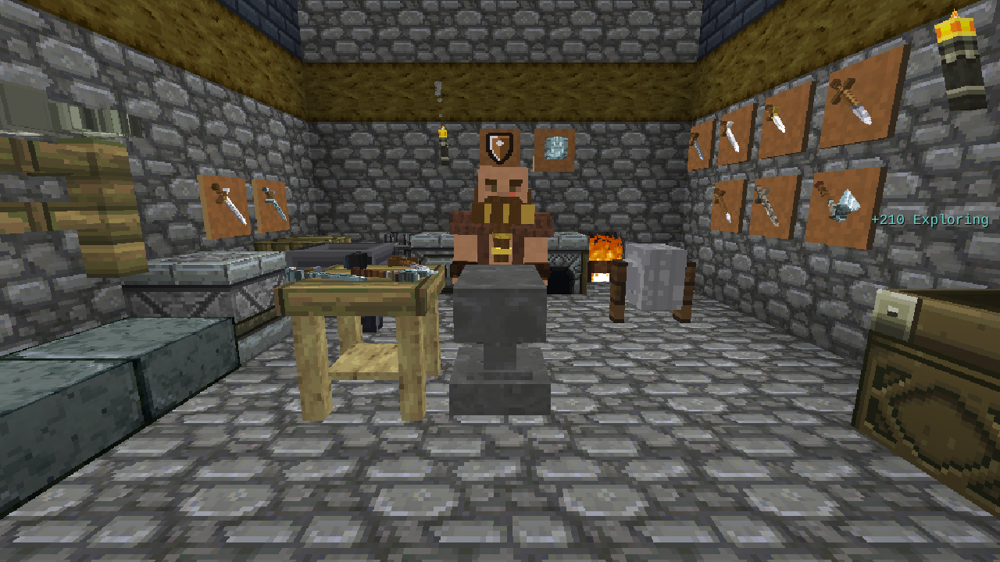 **The smithy**: weapons on the racks, armour on the stands |
| 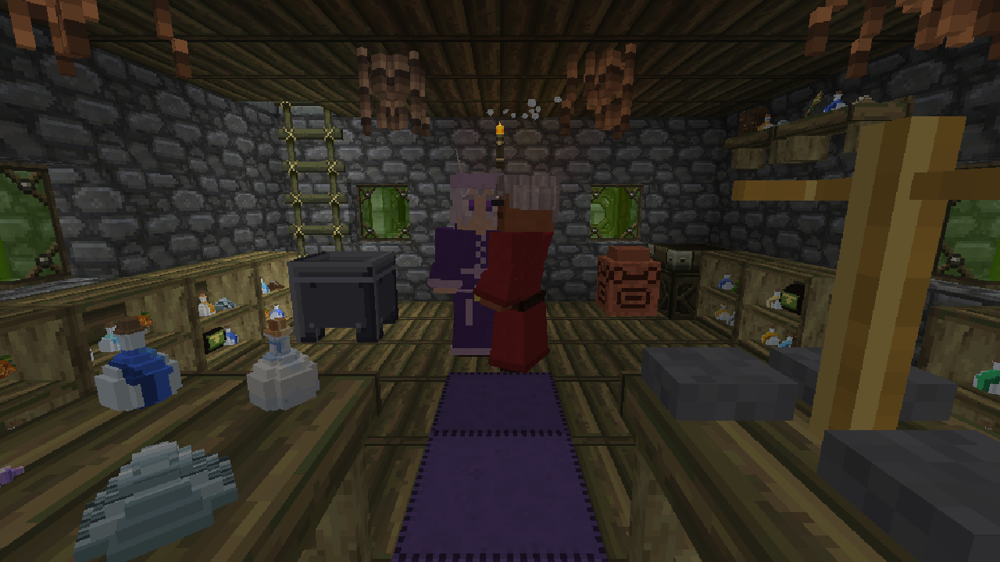 **The apothecary**: potions, herbs and curiosities | 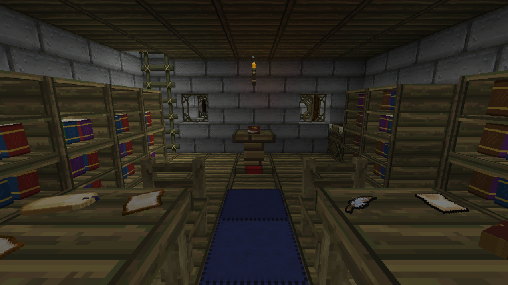 **The library** |
| 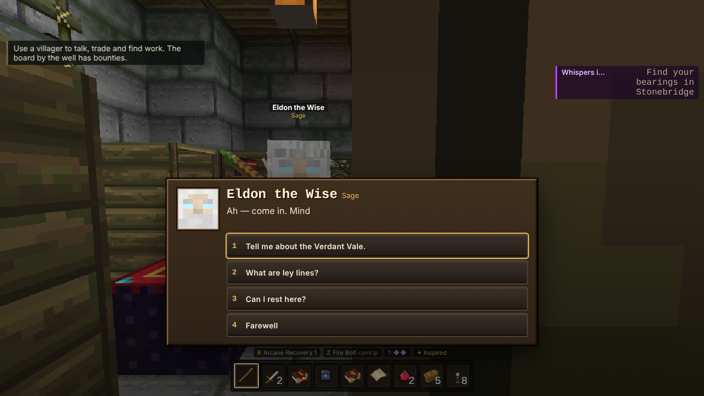 **Conversations** where your skills open doors | 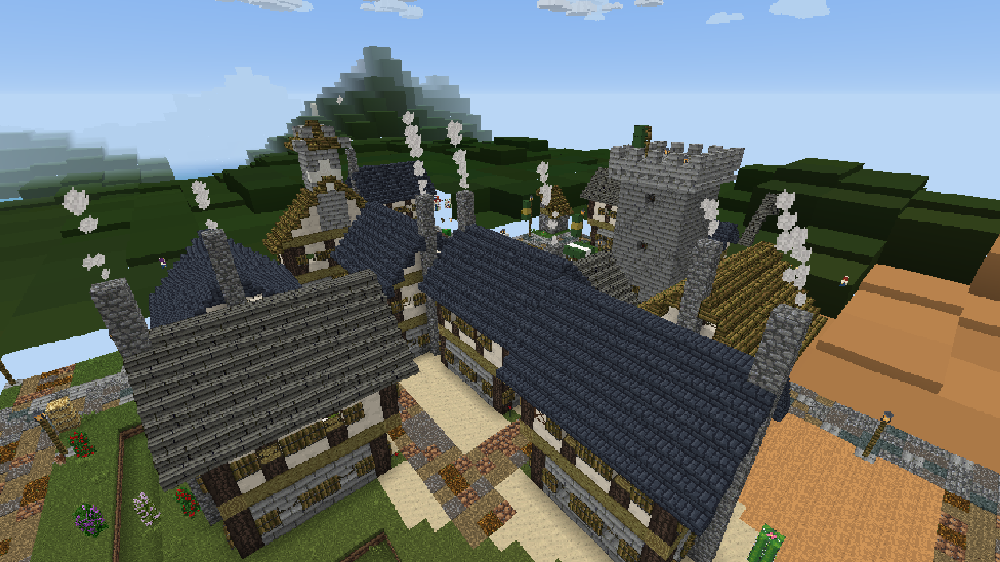 **Oakhaven**, a town at the forest's edge |

## Download

Get the newest version from **[Releases](https://github.com/FartGarfunkel/The-Shadowbloom-of-Eldenwood/releases/latest)**:

- **Linux:** `Shadowbloom-…-x86_64.AppImage`. Make it executable and run it.
- **Windows:** `Shadowbloom-…-windows-x64.zip`. Unzip it anywhere and run `Shadowbloom.exe`.
- **Just the game:** `shadowbloom.html`. Open it in a browser (Chrome, Edge or Firefox), or install it in the desktop app with Options → Install update…

## Updates

The desktop app checks for a new version each time the launcher opens and installs it by itself. When the app itself changes, Options offers **Update the app**. Your worlds are never touched: they're kept in the app's own folder (`~/.config/Shadowbloom` on Linux, `%APPDATA%\Shadowbloom` on Windows), apart from any DokuQuest install.

## Controls (keyboard)

| Key | | Key | |
|---|---|---|---|
| Left click | attack | Right click on someone | talk |
| Z | cast your ready spell | G | ready the next spell |
| B | class feature | N | species feature |
| P | character sheet (short rest) | J | journal |

On a controller: d-pad up casts, d-pad left changes spell, d-pad right is your class feature and a click of the right stick your species feature. The pause menu opens the sheet and the journal too. **How to Play** on the main menu has the rest.

## Recommended resource pack: GeruDoku

The Shadowbloom of Eldenwood has its own textures, painted in the spirit of the classic Doku and Gerudoku packs. For the real thing, we recommend **[GeruDoku](https://github.com/sybenx/GeruDoku)**, the classic pack kept up to date by Sybenx and its contributors. It's what the screenshots above are wearing, and the game uses it for its 3D armour and clothes as well as its blocks and items.

- **Desktop app:** the first time it starts, the app fetches GeruDoku from the pack's own GitHub release by itself. You can also press **Settings → Resource pack → Get GeruDoku** at any time, and **Built-in** switches back.
- **In a browser:** press **Get GeruDoku** to open its release page, download `GeruDoku.1.19.3.v1.zip`, then use **Choose pack (.zip)…** and pick it.

GeruDoku isn't part of The Shadowbloom of Eldenwood and isn't included with it: the game downloads it from GeruDoku's own release. All credit for its art goes to its authors: see the pack's own credits.

## The project

- `src/js/dnd/`: the rules, the hero maker and the looks painter. `src/js/render/gear3d.js`: the 3D gear.
- `src/js/campaign/`: the campaign engine (`engine.js`, `extras.js`) and the campaign itself (`sb_world.js`, `sb_act1.js` to `sb_act3.js`). See `notes/campaign-format.md` to edit it.
- `src/js/game/towns.js`: the towns and their interiors. Everything else is DokuQuest's: `src/js/game`, `world`, `render`, `net`, `ui`.
- Build with `node tools/build.js` → `dist/shadowbloom.html`. Tests (Playwright): `tools/campaign_check.py` (the campaign's connections), `tools/campaign_play.py` (the whole story played by a script), `tools/gear_shot.py`, `tools/menu_shot.py`, `tools/town_test.py`.
- Pushing to `main` builds the game, packages the desktop apps and publishes a release (`.github/workflows/release.yml`).

## Credits and licence notes

This work includes material from the System Reference Document 5.2 ("SRD 5.2") by Wizards of the Coast LLC, available at https://dnd.wizards.com/resources/systems-reference-document. The SRD 5.2 is licensed under the Creative Commons Attribution 4.0 International License, available at https://creativecommons.org/licenses/by/4.0/legalcode.

The interface fonts, Jersey 15 (The Soft Type Project Authors) and Pixelify Sans (The Pixelify Sans Project Authors), are licensed under the SIL Open Font License 1.1; their licences are in `src/fonts/`.

Built on DokuQuest. Not affiliated with or endorsed by Wizards of the Coast, Hypixel Studios or Mojang.
